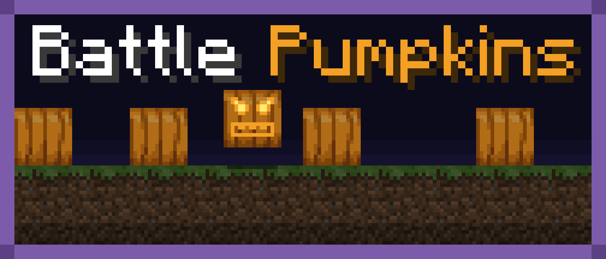
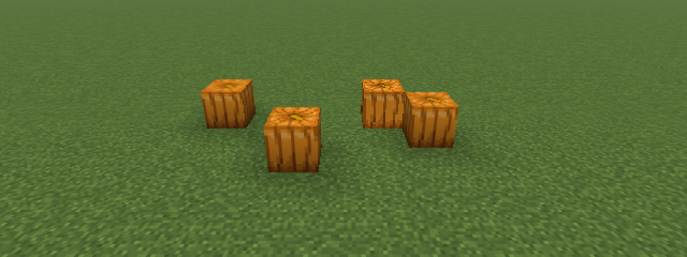
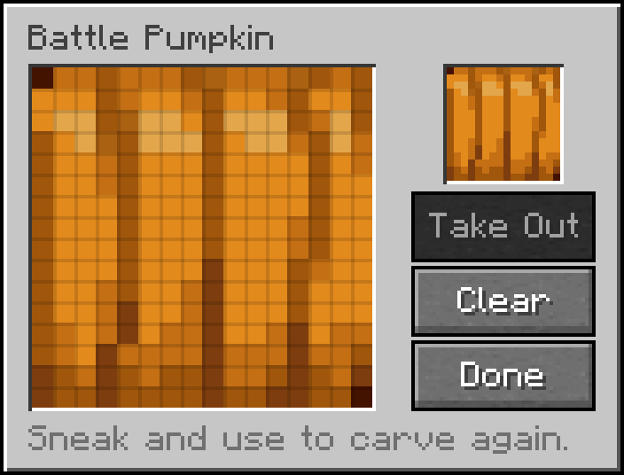
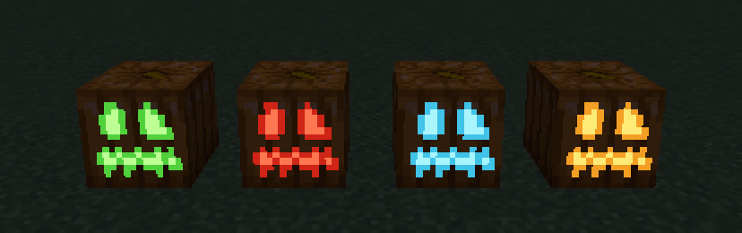
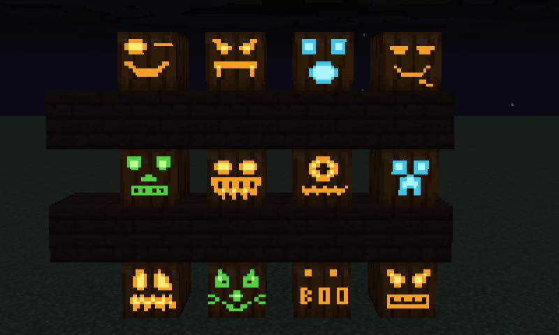
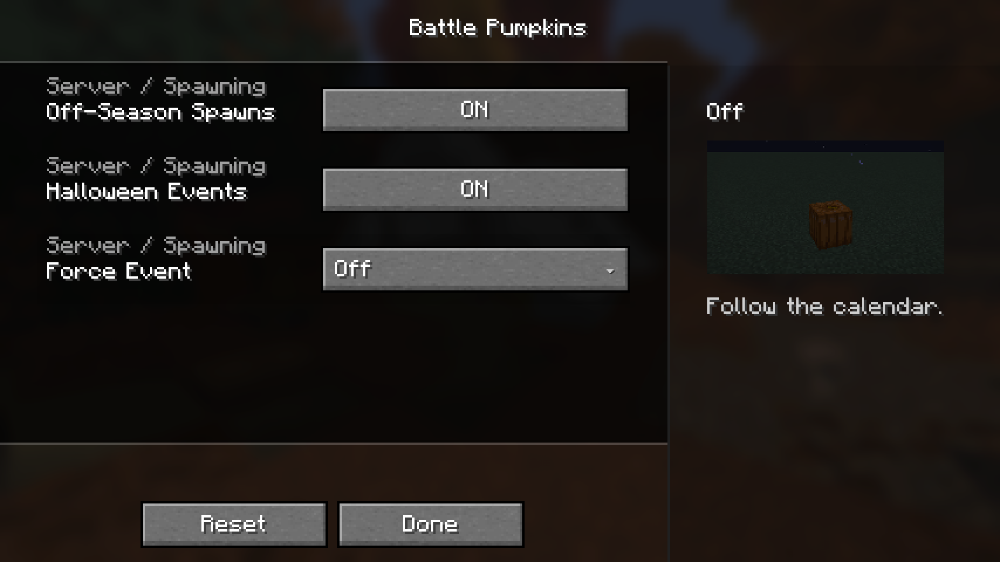

  

  <picture><source media="(prefers-color-scheme: dark)" srcset="https://shieldcn.dev/badge/Minecraft-1.21.11_to_26.3-4ade80.svg?logo=lu:Pickaxe&amp;variant=secondary&amp;mode=dark" /></picture>
  <picture><source media="(prefers-color-scheme: dark)" srcset="https://shieldcn.dev/badge/Loaders-Fabric,_Forge,_NeoForge-5cd2ff.svg?logo=lu:Layers&amp;variant=secondary&amp;mode=dark" /></picture>
  <a href="https://modrinth.com/mod/amber"><picture><source media="(prefers-color-scheme: dark)" srcset="https://shieldcn.dev/badge/Requires-Amber-ebb134.svg?logo=lu:Gem&amp;variant=secondary&amp;mode=dark" /></picture></a>
  <a href="https://modrinth.com/mod/konfig"><picture><source media="(prefers-color-scheme: dark)" srcset="https://shieldcn.dev/badge/Requires-Konfig-a78bfa.svg?logo=lu:SlidersHorizontal&amp;variant=secondary&amp;mode=dark" /></picture></a>
  <a href="LICENSE"><picture><source media="(prefers-color-scheme: dark)" srcset="https://shieldcn.dev/badge/License-PolyForm_Shield-eeeeee.svg?logo=lu:Scale&amp;variant=secondary&amp;mode=dark" /></picture></a>
  <a href="https://discord.gg/HV5WgTksaB"><picture><source media="(prefers-color-scheme: dark)" srcset="https://shieldcn.dev/discord/1207469438719492176.svg?variant=secondary&amp;mode=dark" /></picture></a>

Battle Pumpkins adds a pumpkin you can catch and keep. Wild ones come out at night and sleep through the day in the grass, looking exactly like pumpkin blocks. Catch one with shears, carve its face pixel by pixel, put a torch inside, and it hops along behind you and body-slams anything that hurts you.

## Catching one

Wild Battle Pumpkins spawn on grass in the Overworld at night. Walk up to one and it hops away, so sneak. Hit one and it fights back.

When the sun comes up and nobody is around, a wild one falls asleep. It lines up with the block grid, faces straight ahead, casts no shadow, and holds perfectly still, so it looks like any other pumpkin. Walking within six blocks wakes it up. Sneaking doesn't.

  

Use shears on a wild one to catch it. It gets the classic carved pumpkin face, sits down, and the carving screen opens.

## Carving

The carving screen is a 16×16 grid over the pumpkin's face, one square per pixel. Left-click and drag to carve, right-click and drag to fill pixels back in. **Clear** wipes the face and **Done** saves it. Sneak and right-click your pumpkin any time to carve a new face. Only the owner can carve it.

  

## Lights

Right-click your pumpkin with a torch, soul torch, or redstone torch to put it inside. The carved face glows orange, blue, or red to match. Giving it a different torch pops the old one out, and **Take Out** on the carving screen drops it. Lights only change the color of the face.

  

## Your pumpkin

- Right-click it to make it sit or follow you.
- It bounces after you like a slime and body-slams mobs that hurt you or that you attack, the way a tamed wolf fights for you.
- Pumpkin seeds heal it.
- Name tags work.
- It never despawns.

A Battle Pumpkin you own doesn't die at 0 health. Its light goes out and it falls asleep, keeping its face, and nothing can hurt it until you feed it pumpkin seeds. Then it wakes up with its light back on. The void and `/kill` still remove it.

## Halloween

Battle Pumpkins goes by the real-world date on the server.

- **The rest of the year**, wild Battle Pumpkins are rare.
- **Halloween week, October 25 to 30**, many more show up each night.
- **Lantern Night, October 31**, is the big one. Even more spawn, and every wild one is already carved and lit, wearing one of a dozen Lantern Night faces. Some burn with **witch light**, a green flame you can only get that night. It keeps burning until you swap it for a torch or take it out.

  

## Next Halloween

Battle Pumpkins gets a big update every Halloween. Next year's is the Pumpkin King: one giant Battle Pumpkin per world, and you can catch it.

## Configuration

The settings live in `config/battlepumpkins/server.toml`. Server operators can also change them in game: open Battle Pumpkins' config screen from Mod Menu on Fabric, or with its Config button in the mod list on Forge and NeoForge.

- **Off-Season Spawns** lets wild Battle Pumpkins spawn, rarely, outside Halloween week. On by default.
- **Halloween Events** turns on Halloween week and Lantern Night. On by default.
- **Force Event** runs Halloween week or Lantern Night on any date, for servers and videos. Off by default.

Each setting on the config screen shows a picture of what it changes.

  

## Current support

Battle Pumpkins runs on Fabric, Forge, and NeoForge for Minecraft 1.21.11, 26.1.2, 26.2, and 26.3. Each Minecraft version also gets one jar that runs on all three loaders. Install it on both the client and the server. It requires [Amber](https://modrinth.com/mod/amber) and [Konfig](https://modrinth.com/mod/konfig), and the Fabric version also needs [Fabric API](https://modrinth.com/mod/fabric-api).

## Modpacks and help

You can include Battle Pumpkins in modpacks without asking first.

Lantern Night faces are data files, so datapacks can add their own. Put a JSON file in `data/<namespace>/battle_pumpkin_faces/` with a `rows` list of 16 strings, each 16 characters long: `#` for a carved pixel and `.` for skin.

Found a bug or a bad interaction with another mod? Use the shared [issue tracker](https://github.com/iamkaf/mod-issues/issues). There is also a [Discord](https://discord.gg/HV5WgTksaB) for questions and ideas.
